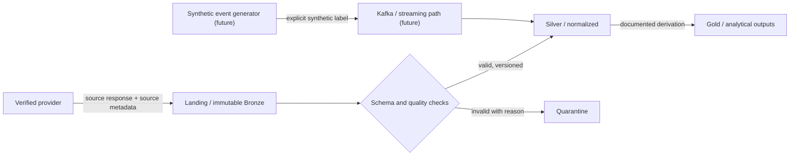

# Data flow and governance

Every ingested observation is expected to carry `source_system`, `dataset_name`,
`source_url`, `ingestion_timestamp`, `observation_date`, `pipeline_run_id`,
`schema_version`, and `record_hash`. Add source-specific identifiers, license
and retrieval metadata where required.

Retain missing values with quality status; deduplicate using source-aware keys
and hashes; normalize units and currencies only with documented context; retain
late observations by observation date and ingestion time; preserve revised
source snapshots; quarantine invalid schemas with actionable reasons; and
measure freshness against source-specific schedules. Never blend official,
derived, and synthetic records without an explicit classification.
