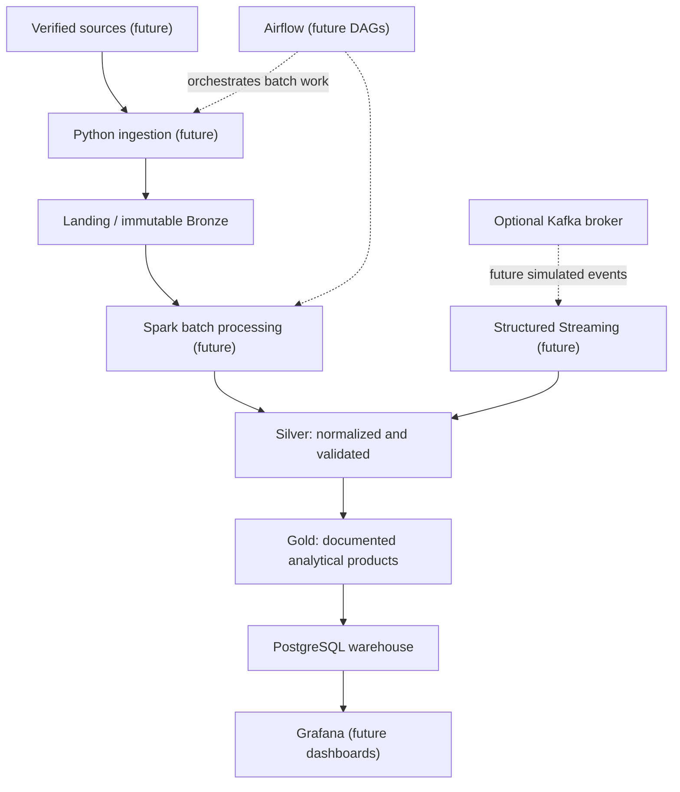

# Logical architecture

Bronze, Silver, and Gold represent distinct trust and transformation boundaries,
not implementations currently present. Preserve original source material and
metadata; make derived and synthetic records identifiable.
