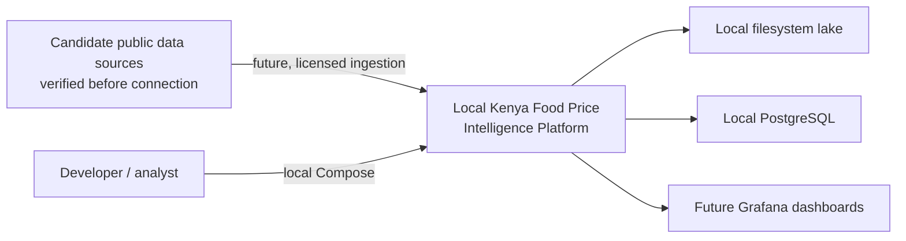

# System context

The platform is a locally operated analytical system. KNBS, World Bank, FAOSTAT,
and any verified county source are candidate external providers, not implemented
or assumed integrations. Users operate local orchestration, compute, storage,
and visualization services.

Only the local service foundation is scaffolded. There are no source
observations, external API credentials, or county-level inflation values in this
repository.
